# ATOMIC_REMEDIATION_ACTION_PLAN.md — Codebase Redesign & Full Action Plan

> **Historical note (2026-11):** the `clip_scoring` decision slot was retired. Step 2 is the writing model plus `sanitize_clips`; this plan's clip-scoring remediation items are closed by removal, not by the redesign described below.

> **Document Status:** Complete Architecture Redesign & Execution Action Plan  
> **Source Audit:** [ATOMIC_AUDIT.md](file:///C:/dev/tafseer-clipper/ATOMIC_AUDIT.md)  
> **Architecture Contract:** [AGENTS.md](file:///C:/dev/tafseer-clipper/AGENTS.md)  
> **Target Platform:** Windows 10/11 x64 (Tauri v2 + FastAPI Sidecar + React 19 Studio)  
> **Standard:** Atomic-tier verification tasks (`[A-01]` through `[A-24]`). Every task is individually verifiable with a stated automated command.

---

## Table of Contents

1. [Executive Summary & Architectural Blueprint](#1-executive-summary--architectural-blueprint)
2. [Domain & Qur'an Integrity Engineering (QRN-01, QRN-02, QRN-03, TXT-01, CUE-01)](#2-domain--quran-integrity-engineering)
3. [Desktop Shell, Sandboxing & Native Runtime Engineering (TAU-01, TAU-02, TAU-03, API-01)](#3-desktop-shell-sandboxing--native-runtime-engineering)
4. [Backend AI Services & FFmpeg Pipeline Redesign (SUB-01, AI-01, FFM-01, FS-01, DEC-01, STT-01, ASYNC-01)](#4-backend-ai-services--ffmpeg-pipeline-redesign)
5. [Frontend State Stores, Audio UI & Subtitle Studio (DEC-02, MEM-01, WAV-01, UI-01, DISC-01, STOR-01)](#5-frontend-state-stores-audio-ui--subtitle-studio)
6. [Build Engineering, Packaging & CI/CD Hardening (CICD-01, CICD-02)](#6-build-engineering-packaging--cicd-hardening)
7. [Comprehensive Task Dependency Graph & Risk Classification](#7-comprehensive-task-dependency-graph--risk-classification)
8. [Chronological Execution Roadmap (Atomic Tasks [A-01] to [A-24])](#8-chronological-execution-roadmap-atomic-tasks)
9. [Verification Suite & Acceptance Gates](#9-verification-suite--acceptance-gates)

---

## 1. Executive Summary & Architectural Blueprint

[ATOMIC_AUDIT.md](file:///C:/dev/tafseer-clipper/ATOMIC_AUDIT.md) identified 24 distinct vulnerabilities across religious text integrity, desktop sandboxing, runtime concurrency, subtitle typography, mathematical models, AI routing, and CI/CD engineering.

This document establishes the **authoritative architectural redesign and end-to-end execution action plan** to systematically eliminate every audited defect while strictly adhering to the architectural contract in [AGENTS.md](file:///C:/dev/tafseer-clipper/AGENTS.md):
- **Fixed REST Surface:** No new endpoints; additive, backwards-compatible schemas only.
- **3-Layer UI Stack:** Zero hand-rolled primitives; `shadcn/ui` + `Base UI` + Tailwind CSS; Sonner, Vaul, cmdk, NumberFlow, wavesurfer.js; exactly one Magic UI dropzone.
- **Hardware Neutrality:** Seamless CPU fallback with zero vendor-specific branding.
- **Strict Islamic Text Integrity:** Zero tolerance for text substitution, anagram false positives, or vocalization mutilation.

```mermaid
flowchart TD
    subgraph UI ["Layer 1 & 2: Frontend (React 19 / Zustand)"]
        direction TB
        Drop["Magic UI Dropzone (Step 1)"]
        Deck["Keep & Re-roll Deck (Step 2)"]
        Monitor["Subtitle Studio & Waveform (Step 3)"]
        Batch["Batch Export Monitor (Step 4)"]
    end

    subgraph Native ["Desktop Shell (Tauri v2 Rust)"]
        Port["Atomic Handshake Socket"]
        Scope["Dynamic FS Path Scoper"]
        Dialog["Native Dialog Plugin"]
    end

    subgraph Sidecar ["Python 3.12 FastAPI Sidecar"]
        QEngine["Ordered Quran Matcher & Sub-verse Align"]
        Splitter["Context-Decoupled Transcript Windowing"]
        DecAdapter["Universal Cloud Decision Transport"]
        Renderer["Filtergraph Escaper & Dual .ass Engine"]
        GC["Periodic Disk Cache Evictor"]
    end

    UI <-->|Tauri IPC / Native Dialogs| Native
    Native -->|Spawns with Atomic Port| Sidecar
    UI <-->|REST + SSE (/render-batch)| Sidecar
```

---

## 2. Domain & Qur'an Integrity Engineering

### 2.1 Issue QRN-01: Un-ordered Bag-of-Words Anagram Overwrite Vulnerability
- **Severity:** `CRITICAL`
- **Impacted Files:**
  - [backend/services/quran.py#L143-L189](file:///C:/dev/tafseer-clipper/backend/services/quran.py#L143-L189)
  - [backend/services/recitation.py#L88-L105](file:///C:/dev/tafseer-clipper/backend/services/recitation.py#L88-L105)

#### Root Cause Analysis
`quran.py:match_text()` calculates:
```python
intersection = len(query_set & verse.words)
overlap = intersection / max(len(query_set), len(verse.words))
score = max(overlap, ratio)
```
Set intersection ignores token sequence order. If an Arabic phrase contains common words shared with a short verse, `overlap` reaches 0.80+, exceeding the 0.58 threshold even when the syntax is completely different. In `recitation.py:_replacement_for_span`, `text = match.arabic` unconditionally overwrites the spoken audio transcription with the matched verse text.

#### Redesign & Engineering Specification
1. **Enforce Monotonic Word-Order Sequence Matching in `quran.py`:**
   - Eliminate `score = max(overlap, ratio)`. Set overlap must **only** serve as a fast candidate prune filter (`overlap >= 0.50`), never as the final confidence metric.
   - Final confidence score must be governed by ordered character and token sequence ratio:
     $$\text{score} = \text{SequenceMatcher}(\text{query}, \text{verse.normalized}).\text{ratio}()$$
   - Query length threshold: For queries $\le 3$ words, require $\text{score} \ge 0.85$. For queries $> 3$ words, require $\text{score} \ge 0.78$.
2. **Conditional Non-Destructive Replacement in `recitation.py`:**
   - Replace spoken text with `match.arabic` **only** if:
     1. Exact normalized equality holds: `normalize_arabic(match.arabic) == normalize_arabic(text)`, OR
     2. High-confidence verbatim match: `match.score >= 0.88` AND the word sequence alignment is continuous.
   - For all other partial or lower-confidence matches ($0.70 \le \text{score} < 0.88$): keep the verbatim Whisper transcription as `text`, set `reference = match.reference`, `confidence = match.score`, and `source = "recitation"`. This preserves the speaker's exact spoken words while annotating the reference.

---

### 2.2 Issue QRN-02: Partial-Verse Recitations Matching Failure
- **Severity:** `HIGH`
- **Impacted Files:**
  - [backend/services/quran.py#L174-L182](file:///C:/dev/tafseer-clipper/backend/services/quran.py#L174-L182)
  - [backend/services/verify.py#L64-L80](file:///C:/dev/tafseer-clipper/backend/services/verify.py#L64-L80)

#### Root Cause Analysis
In `quran.py:match_text`, the denominator `max(len(query_set), len(verse.words))` dilutes a 10-word query inside a 50-word verse (e.g. Ayat al-Kursi) to $10 / 50 = 0.20$, which immediately triggers `if overlap < threshold * 0.75: continue`. Furthermore, `corpus_gate` in `verify.py` requires `normalize_arabic(match.arabic) == normalize_arabic(stripped)`, rejecting all sub-verse recitations.

#### Redesign & Engineering Specification
1. **Sub-verse Sliding-Window Token Alignment:**
   - In `quran.py`, when $\text{len}(\text{query\_words}) < \text{len}(\text{verse.words})$:
     - Slide a token window of size $W = \text{len}(\text{query\_words}) + 1$ across `verse.normalized.split()`.
     - Find the sub-window with maximum token intersection.
     - Compute local sequence ratio:
       $$\text{sub\_ratio} = \text{SequenceMatcher}(\text{query}, \text{sub\_window\_text}).\text{ratio}()$$
     - Score is calculated against the sub-window, not the whole verse length.
2. **Corpus Gate Sub-Verse Acceptance in `verify.py`:**
   - Extend `corpus_gate(text)`:
     ```python
     if match and (
         quran.normalize_arabic(match.arabic) == quran.normalize_arabic(stripped)
         or (match.score >= 0.90 and quran.normalize_arabic(stripped) in quran.normalize_arabic(match.arabic))
     ):
         return VerifyOutcome(
             verified_text=stripped if stripped in match.arabic else match.arabic,
             correction_applied=False,
             notes=f"Matches Qur'an passage ({match.reference}).",
             source="quran",
             reference=match.reference,
             confidence=match.score,
         )
     ```

---

### 2.3 Issue QRN-03: Acoustic Recitation Boundary Midpoint Truncation Bug
- **Severity:** `HIGH`
- **Impacted File:** [backend/services/recitation.py#L150-L157](file:///C:/dev/tafseer-clipper/backend/services/recitation.py#L150-L157)

#### Root Cause Analysis
In `recover_arabic`, segment removal filters using:
`start - 0.05 <= (segment.start + segment.end) / 2 <= end + 0.05`
A boundary segment straddling the recitation edge whose midpoint falls outside $[start, end]$ is not removed. The replacement segment bounds snap to `min(segment.start for segment in removed)`, causing audio-subtitle desync and overlapping Thai/Arabic cues.

#### Redesign & Engineering Specification
1. **Temporal Interval Overlap & Boundary Splitting:**
   - Replace midpoint check with strict interval intersection:
     $$\text{overlap} = \max(0.0, \min(\text{segment.end}, \text{end}) - \max(\text{segment.start}, \text{start}))$$
   - If $\text{overlap} > 0.15\text{s}$:
     - If `segment.start < start - 0.2`: split segment at `start`, preserving the leading Thai speech in $[segment.start, start]$.
     - If `segment.end > end + 0.2`: split segment at `end`, preserving the trailing Thai speech in $[end, segment.end]$.
     - Completely contained segments are marked for removal.
2. **True Acoustic Boundary Snapping:**
   - The replacement Arabic recitation segment must be bounded by `start` and `end` (the exact acoustic slice boundaries identified during the Arabic audit), preventing cue jitter.

---

### 2.4 Issue TXT-01: Arabic Unicode Harakat Code-Point Inflation in Subtitle Wrapping
- **Severity:** `HIGH`
- **Impacted Files:**
  - [src/lib/subtitleWrap.ts#L181-L206](file:///C:/dev/tafseer-clipper/src/lib/subtitleWrap.ts#L181-L206)
  - [src/store/renderStore.ts#L169-L175](file:///C:/dev/tafseer-clipper/src/store/renderStore.ts#L169-L175)

#### Root Cause Analysis
`wrapArabicText` measures line fit using `word.length` (UTF-16 code units). Qur'anic vocalized Arabic contains extensive non-spacing Tashkeel, Sukun, Shaddah, and Quranic pause marks, inflating string length to 2x–3x visual glyphs (e.g., 4-word Bismillah = 39 code units). The wrapper prematurely breaks short verses across 2 or 3 lines.

#### Redesign & Engineering Specification
1. **Grapheme & Base-Letter Width Metric:**
   - Create `arabicVisualLength(text: string): number`:
     ```typescript
     const ARABIC_COMBINING_REGEX = /[\u0610-\u061A\u064B-\u065F\u0670\u06D6-\u06ED]/g;
     export function arabicVisualLength(text: string): number {
       return text.replace(ARABIC_COMBINING_REGEX, "").length;
     }
     ```
   - In `wrapArabicText`, track `currentVisualLength` and compare `currentVisualLength + 1 + arabicVisualLength(word) <= maxChars`.
   - The wrapped output retains all original combining diacritical marks.

---

### 2.5 Issue CUE-01: Non-Spacing Diacritics Duration Distortion in Cue Math
- **Severity:** `MEDIUM`
- **Impacted File:** [src/lib/subtitleCues.ts#L153-L165](file:///C:/dev/tafseer-clipper/src/lib/subtitleCues.ts#L153-L165)

#### Root Cause Analysis
`buildLetters` partitions duration uniformly across `source.length` code units:
`start + ((end - start) * index) / count`. Non-spacing diacritics receive acoustic duration, skewing word boundaries and splitting astral-plane surrogate pairs.

#### Redesign & Engineering Specification
- Use `Intl.Segmenter(lang, { granularity: "grapheme" })` to segment text into true Unicode grapheme clusters.
- Allocate acoustic duration strictly across grapheme clusters. Combining diacritics attach to their base character and share its timestamp window.

---

## 3. Desktop Shell, Sandboxing & Native Runtime Engineering

### 3.1 Issue TAU-01: Tauri Filesystem Sandbox Violation on Secondary Drives
- **Severity:** `CRITICAL`
- **Impacted Files:**
  - [src-tauri/capabilities/default.json#L15-L55](file:///C:/dev/tafseer-clipper/src-tauri/capabilities/default.json#L15-L55)
  - [src/lib/projectFile.ts#L516-L545](file:///C:/dev/tafseer-clipper/src/lib/projectFile.ts#L516-L545)
  - [src/components/config/SettingsScreen.tsx#L255-L295](file:///C:/dev/tafseer-clipper/src/components/config/SettingsScreen.tsx#L255-L295)

#### Root Cause Analysis
`src-tauri/capabilities/default.json` restricts `fs:allow-read-text-file`, `write`, `mkdir`, `exists`, `remove` strictly to:
`$LOCALDATA/**`, `$APPDATA/**`, `$HOME/**`, `$DOCUMENT/**`.
When an editor configures `storage.projectFolder` to a secondary SSD (e.g. `D:\TafseerProjects`), all auto-save writes are rejected by Tauri IPC with `Forbidden path`.

#### Redesign & Engineering Specification
1. **Tauri v2 Filesystem Scope Granting:**
   - In `src-tauri/src/lib.rs`, register an IPC command:
     ```rust
     #[tauri::command]
     fn grant_project_folder_scope(app: tauri::AppHandle, folder_path: String) -> Result<(), String> {
         let path = PathBuf::from(&folder_path);
         if !path.exists() {
             std::fs::create_dir_all(&path).map_err(|e| e.to_string())?;
         }
         let scope = app.fs_scope();
         scope.allow_directory(&path, true).map_err(|e| e.to_string())?;
         Ok(())
     }
     ```
   - In `capabilities/default.json`, maintain strict default paths, while enabling dynamic extension when the user configures the setting or selects a directory via the native folder dialog.
2. **Durable Local Fallback in `projectFile.ts`:**
   - If writing to custom `projectFolder` fails with a permission/IO error, automatically fall back to writing the snapshot into `<appLocalDataDir>/projects/`, log the incident, and set `lastAutosaveError: "Custom folder not writable; saved to local backup"`. Project edits are never lost.

---

### 3.2 Issue TAU-02: Ephemeral Loopback Port Allocation Race Condition at Shell Startup
- **Severity:** `CRITICAL`
- **Impacted File:** [src-tauri/src/lib.rs#L62-L73, L300-L315](file:///C:/dev/tafseer-clipper/src-tauri/src/lib.rs#L62-L73)

#### Root Cause Analysis
`pick_free_loopback_port()` binds `127.0.0.1:0`, drops the socket listener, and passes `--port <port>` to `backend.exe`. During the 2–5 second PyInstaller onedir initialization, the port is unreserved. Another process or test worker can bind to it, causing `backend.exe` to crash with `WSAEADDRINUSE`.

#### Redesign & Engineering Specification
1. **Dynamic Port Negotiation via Stdout Handshake:**
   - Shell passes `--port 0` to `backend.exe`.
   - In `backend/main.py`, Uvicorn binds to `127.0.0.1:0`, allowing the OS kernel to assign an ephemeral port atomically at the exact moment of socket creation.
   - At startup, the sidecar writes an unbuffered handshake line to stdout:
     `TAFSEER_SIDECAR_READY:port=XXXXX`
   - In `src-tauri/src/lib.rs`, `spawn_sidecar` reads stdout until the handshake marker is received (with a 10s timeout), captures the assigned port, and injects `window.__TAFSEER_SIDECAR_URL__ = format!("http://127.0.0.1:{port}")`.
   - Eliminates port collision race conditions with zero external dependencies.

---

### 3.3 Issue TAU-03: Absence of Native Save/Open Dialogs in Desktop Runtime
- **Severity:** `MEDIUM`
- **Impacted Files:**
  - [src/lib/projectFile.ts#L337-L405](file:///C:/dev/tafseer-clipper/src/lib/projectFile.ts#L337-L405)
  - [src-tauri/capabilities/default.json#L12](file:///C:/dev/tafseer-clipper/src-tauri/capabilities/default.json#L12)

#### Root Cause Analysis
`projectFile.ts` uses HTML5 `showSaveFilePicker`, which is disabled/unsupported in WebView2, falling back to `<a download>` DOM injection. This dumps `.tafseer` files into `Downloads` instead of opening the native Windows Save File dialog.

#### Redesign & Engineering Specification
In `src/lib/projectFile.ts`:
```typescript
import { isDesktopRuntime } from "./platform";

export async function saveProjectFile(project: ProjectData): Promise<"saved" | "cancelled"> {
  const text = serializeProject(project);
  const fileName = suggestProjectFileName(project);

  if (isDesktopRuntime()) {
    const { save } = await import("@tauri-apps/plugin-dialog");
    const { writeTextFile } = await import("@tauri-apps/plugin-fs");
    const selected = await save({
      defaultPath: fileName,
      filters: [{ name: "Tafseer Project (*.tafseer)", extensions: ["tafseer"] }],
    });
    if (!selected) return "cancelled";
    await writeTextFile(selected, text);
    return "saved";
  }

  // Web/HMR fallback
  downloadText(text, fileName);
  return "saved";
}
```
Apply corresponding logic for `openProjectFile` using `open({ filters: [...] })` and `readTextFile`.

---

### 3.4 Issue API-01: Premature Static Evaluation of `SIDECAR_URL`
- **Severity:** `LOW`
- **Impacted File:** [src/lib/api.ts#L45](file:///C:/dev/tafseer-clipper/src/lib/api.ts#L45)

#### Redesign & Engineering Specification
Export a dynamic accessor function `getSidecarUrl(): string` and maintain backward compatibility via an ES Proxy or getter:
```typescript
export function getSidecarUrl(): string {
  return resolveSidecarUrl();
}
export const SIDECAR_URL = {
  toString: () => getSidecarUrl(),
  valueOf: () => getSidecarUrl(),
};
```
Refactor all internal `api.ts` requests (`fetch(`${getSidecarUrl()}/...`)`) to invoke `getSidecarUrl()` dynamically on each request.

---

## 4. Backend AI Services & FFmpeg Pipeline Redesign

### 4.1 Issue SUB-01: Subtitle Styling & Metric Divergence Between Frontend and Backend Defaults
- **Severity:** `CRITICAL`
- **Impacted Files:**
  - [backend/services/subtitle_gen.py#L145-L180](file:///C:/dev/tafseer-clipper/backend/services/subtitle_gen.py#L145-L180)
  - [src/lib/subtitleStyles.ts#L87-L150](file:///C:/dev/tafseer-clipper/src/lib/subtitleStyles.ts#L87-L150)

#### Root Cause Analysis
`subtitle_gen.py:default_styles()` hardcodes `Tahoma`, size 66, `#FFD37A`, no box opacity. Frontend defaults in `subtitleStyles.ts` use `Noto Naskh Arabic`, size 64/54, warm gold `#dcb46e`, Thai Leelawadee UI size 44/38 `#f4f4f1`, box opacity 0.15. Renders generated in fallback or automated paths diverge visibly from the Subtitle Monitor preview.

#### Redesign & Engineering Specification
Update `backend/services/subtitle_gen.py:default_styles()` to match `subtitleStyles.ts` exactly:
- **Portrait (1080x1920):**
  - Arabic: `font="Noto Naskh Arabic"`, `size=64`, `primary_color="#dcb46e"`, `margin_v=252`, `margin_l=54`, `margin_r=54`, `outline=2.0`, `shadow=1.0`.
  - Thai: `font="Leelawadee UI"`, `size=44`, `primary_color="#f4f4f1"`, `box_opacity=0.15`, `margin_v=160`, `margin_l=54`, `margin_r=54`, `outline=3.0`, `shadow=1.0`.
- **Landscape (1920x1080):**
  - Arabic: `font="Noto Naskh Arabic"`, `size=54`, `primary_color="#dcb46e"`, `margin_v=142`, `margin_l=80`, `margin_r=80`.
  - Thai: `font="Leelawadee UI"`, `size=38`, `primary_color="#f4f4f1"`, `box_opacity=0.15`, `margin_v=80`, `margin_l=80`, `margin_r=80`.

---

### 4.2 Issue AI-01: Discovery Window Budget Collapse on Low `max_clips`
- **Severity:** `HIGH`
- **Impacted File:** [backend/services/analyzer.py#L610-L625](file:///C:/dev/tafseer-clipper/backend/services/analyzer.py#L610-L625)

#### Root Cause Analysis
`window_budget = min(MAX_DISCOVERY_WINDOWS, max(1, max_clips))`. When `max_clips = 1`, `window_budget = 1`. For a 3-hour lecture, the entire 100,000+ character transcript is packed into a single prompt, overflowing context limits.

#### Redesign & Engineering Specification
1. **Decouple Transcript Chunk Windowing from Output `max_clips`:**
   - Windowing is strictly dictated by the transcript size and model context limits:
     $$\text{num\_windows} = \max\left(1, \left\lceil \frac{\text{total\_chars}}{\text{TARGET\_WINDOW\_CHARS}} \right\rceil\right)$$
     where $\text{TARGET\_WINDOW\_CHARS} = 24,000$ (approx. 5,000–6,000 tokens).
2. **Dynamic Per-Window Candidate Over-Sampling:**
   - Each window generates $\max\left(2, \lceil \frac{max\_clips \times 1.5}{num\_windows} \rceil\right)$ candidates, ensuring full temporal coverage of the lecture.
3. **Global Candidate Pooling & Ranking:**
   - Pool all candidates across windows and execute global ranking and deduplication via `sanitize_proposals`, returning the top `max_clips` finalists.

---

### 4.3 Issue FFM-01: FFmpeg Filtergraph Single-Quote Escaping & Literal Backslash Path Invalidation
- **Severity:** `HIGH`
- **Impacted File:** [backend/services/renderer.py#L155-L166, L182-L185](file:///C:/dev/tafseer-clipper/backend/services/renderer.py#L155-L166)

#### Root Cause Analysis
In `escape_filter_path`, `text.replace(":", "\\:")` and bracket escapes produce `filename='C\:/work/\[clips\]/clip.ass'`. Inside FFmpeg single quotes `'...'`, the only character escaped by `\` is `'` and `\`. All other backslashes are preserved literally, causing Windows path lookup failure.

#### Redesign & Engineering Specification
Rewrite `escape_filter_path`:
```python
def escape_filter_path(path: str | Path) -> str:
    """Escape a path for inclusion inside single-quoted filter values in FFmpeg."""
    text = str(Path(path).resolve()).replace("\\", "/")
    # Inside '...', only ' needs escaping
    return text.replace("'", "'\\''")
```

---

### 4.4 Issue FS-01: Permanent Disk Cache Accumulation During Runtime
- **Severity:** `MEDIUM`
- **Impacted File:** [backend/main.py#L885-L930](file:///C:/dev/tafseer-clipper/backend/main.py#L885-L930)

#### Redesign & Engineering Specification
1. Add a background task loop spawned during FastAPI `lifespan`:
   ```python
   async def _periodic_prune_task() -> None:
       while True:
           await asyncio.sleep(3600)  # Every 60 minutes
           await run_in_threadpool(_prune_work_dir)
   ```
2. Implement a 5 GB hard ceiling quota in `_prune_work_dir`: If total directory size exceeds 5 GB, evict oldest audio WAV files until total size falls below 4 GB.
3. Call `_prune_work_dir` on completion of `/render-batch`.

---

### 4.5 Issue DEC-01: Cloud Decision Model Protocol Mismatch & 404 Dead-End (`/v1/systemone` vs OpenAI Gateways)
- **Severity:** `HIGH`
- **Impacted Files:**
  - [backend/services/decision.py#L47-L52, L771-L803](file:///C:/dev/tafseer-clipper/backend/services/decision.py#L47-L52)
  - [src/components/config/SettingsScreen.tsx#L450-L478](file:///C:/dev/tafseer-clipper/src/components/config/SettingsScreen.tsx#L450-L478)

#### Root Cause Analysis
`WIRE_FORMAT_PATHS` only supports `/v1/systemone` and `/v1/decisions`. Standard OpenAI-compatible gateways (Vercel AI Gateway, OpenAI, OpenRouter, Groq, Together) return 404. Settings "Test" triggers a circular error instructing the user to press Test in Settings.

#### Redesign & Engineering Specification
1. **Add `CHAT_COMPLETIONS` Wire Format (`/v1/chat/completions`):**
   - In `backend/services/decision.py`, define `CHAT_COMPLETIONS = "chat_completions"`.
   - When `wire_format == "chat_completions"` (or when auto-probing detects 404 on both `/v1/systemone` and `/v1/decisions`):
     - Translate typed questions into a structured prompt requesting JSON output (`response_format: {"type": "json_object"}`).
     - Parse JSON reply and construct `DecisionBatch` matching typed return expectations (`noul`, `choice`, `score`).
2. **Settings Format Detection:**
   - In `detect_format()`, if `/v1/systemone` and `/v1/decisions` both return 404, probe `/v1/chat/completions`. If successful, record format as `chat_completions`.
   - Cloud decision slots work seamlessly with any standard OpenAI-compatible gateway.

---

### 4.6 Issue STT-01: Cloud STT Model Override Fallback in Recitation Recovery
- **Severity:** `MEDIUM`
- **Impacted File:** [backend/main.py#L1866-L1875](file:///C:/dev/tafseer-clipper/backend/main.py#L1866-L1875)

#### Redesign & Engineering Specification
In `transcribe_span`, if `body.arabic_model` is specified but returns HTTP 400 or 404 (model not found on that endpoint), log a warning and automatically retry the span using `body.cloud.model` before failing.

---

### 4.7 Issue ASYNC-01: Disconnect Poller Starvation on Synchronous CPU-Bound Operations
- **Severity:** `LOW`
- **Impacted File:** [backend/main.py#L1680-L1715](file:///C:/dev/tafseer-clipper/backend/main.py#L1680-L1715)

#### Redesign & Engineering Specification
Ensure all CPU-bound operations (regex normalization, text slicing, font parsing) are executed in `run_in_threadpool` or yield control with `await asyncio.sleep(0)` at segment loops, guaranteeing that `request.is_disconnected()` is evaluated every 0.5s.

---

## 5. Frontend State Stores, Audio UI & Subtitle Studio

### 5.1 Issue DEC-02: Clip Finding Model Attribution Suppression & Discovery Role Inversion
- **Severity:** `HIGH`
- **Impacted Files:**
  - [src/steps/Step2Discovery.tsx#L443-L473](file:///C:/dev/tafseer-clipper/src/steps/Step2Discovery.tsx#L443-L473)
  - [backend/services/analyzer.py#L1035-L1138](file:///C:/dev/tafseer-clipper/backend/services/analyzer.py#L1035-L1138)

#### Root Cause Analysis
`Step2Discovery.tsx:473` suppresses `result.model` if a decision slot is active, misattributing the entire lecture analysis to a tiny 0.5B decision model. In the backend, `_discover_with_decisions` demotes the generative LLM to a title generator, while the decision model picks clips from pause slices.

#### Redesign & Engineering Specification
1. **Frontend Attribution Transparency:**
   - Update `aiActivityStore.finish`: Always pass `result.model` (the generative LLM).
   - Display a combined badge in recent activity:
     `[Clip finding] gpt-4o · Assisted by Spark-X (Fast Scoring)`
2. **Semantic Discovery Architecture:**
   - In `analyzer.py`, restore semantic authority to the generative LLM: The LLM discovers candidate narrative clips and thematic arcs. The decision model is used for boundary refinement and scoring validation, not autonomous blind clip selection.

---

### 5.2 Issue MEM-01: Orphaned Cue Track Memory Leak in Project Auto-Save File
- **Severity:** `HIGH`
- **Impacted File:** [src/lib/taskResults.ts#L86-L114](file:///C:/dev/tafseer-clipper/src/lib/taskResults.ts#L86-L114)

#### Root Cause Analysis
In `applyDiscovery`, unapproved clips discarded on a re-roll are removed from `project.clips`, but their subtitle tracks remain permanently inside `project.subtitles[clipId]`, bloating project files.

#### Redesign & Engineering Specification
In `applyDiscovery`:
```typescript
const validClipIds = new Set(merged.map((clip) => clip.id));
const cleanedSubtitles: Record<string, SubtitleCue[]> = {};
for (const [clipId, cues] of Object.entries(project.subtitles)) {
  if (validClipIds.has(clipId)) {
    cleanedSubtitles[clipId] = cues;
  }
}
return {
  ...project,
  clips: merged,
  subtitles: cleanedSubtitles,
  selectedClipId,
};
```

---

### 5.3 Issue WAV-01: Excessive Canvas Allocation and Memory Spike on Long Lectures
- **Severity:** `MEDIUM`
- **Impacted File:** [src/components/WaveformBar.tsx#L158-L171](file:///C:/dev/tafseer-clipper/src/components/WaveformBar.tsx#L158-L171)

#### Root Cause Analysis
`wavesurfer.zoom(width / visibleSpan)` zooms across the entire 3-hour audio. A 30s clip requires a 324,000-pixel canvas, exceeding WebView2 texture dimensions and triggering renderer crashes.

#### Redesign & Engineering Specification
1. **Sub-Window Waveform Rendering:**
   - Restrict the rendered waveform window to $[clipStart - 5\text{s}, clipEnd + 5\text{s}]$ (or the clip range).
   - Slice the precomputed peaks array so wavesurfer renders only the active time window.
   - Canvas width remains locked to container width ($\le 1200\text{ px}$), keeping memory consumption under 1 MB.

---

### 5.4 Issue UI-01: Lack of Arabic Column Fit Estimation and Visual Overflow Safeguards
- **Severity:** `LOW`
- **Impacted File:** [src/lib/subtitleWidth.ts#L66-L100](file:///C:/dev/tafseer-clipper/src/lib/subtitleWidth.ts#L66-L100)

#### Redesign & Engineering Specification
Implement `arabicColumnWidthPx` and `estimateArabicLineFit` in `subtitleWidth.ts` using representative vocalized Qur'anic text:
- Measure canvas advance per grapheme cluster.
- Surface a warning indicator in `SettingsScreen.tsx` if the selected Arabic font size and margins cause column overflow on 9:16 vertical video.

---

### 5.5 Issue DISC-01: Silent Drop on Empty Discovery Re-roll
- **Severity:** `LOW`
- **Impacted File:** [src/lib/taskResults.ts#L98-L102](file:///C:/dev/tafseer-clipper/src/lib/taskResults.ts#L98-L102)

#### Redesign & Engineering Specification
In `Step2Discovery.tsx`, if `result.clips.length === 0`, trigger a Sonner toast:
`toast.info("No new clips found matching the current settings. Try expanding duration limits.")`
Ensure the user receives immediate visual feedback.

---

### 5.6 Issue STOR-01: Unbounded `recentProjects` and LocalStorage Quota Depletion Risk
- **Severity:** `LOW`
- **Impacted Files:**
  - [src/store/projectStore.ts#L370-L385](file:///C:/dev/tafseer-clipper/src/store/projectStore.ts#L370-L385)
  - [src/lib/projectFile.ts#L416-L426](file:///C:/dev/tafseer-clipper/src/lib/projectFile.ts#L416-L426)

#### Redesign & Engineering Specification
- In desktop runtime, `localStorage` must only store lightweight session index metadata (`RecentProject` summaries).
- Full `.tafseer` project states are written exclusively to disk via `writeAutosaveFile`.
- In browser fallback, limit stored full projects to 3, evicting oldest payloads when `QuotaExceededError` occurs.

---

## 6. Build Engineering, Packaging & CI/CD Hardening

### 6.1 Issue CICD-01: Path Discrepancy in `release.yml` for Build Provenance Attestation
- **Severity:** `MEDIUM`
- **Impacted File:** [.github/workflows/release.yml#L141-L144, L162-L166](file:///C:/dev/tafseer-clipper/.github/workflows/release.yml#L141-L144)

#### Root Cause Analysis
`release.yml` locates NSIS artifacts dynamically between `src-tauri\target\release\bundle\nsis` and `.cargo-target\release\bundle\nsis`. Line 165 hardcodes `subject-path: "src-tauri/target/release/bundle/nsis/*.exe"`, failing provenance attestation if `.cargo-target` was used.

#### Redesign & Engineering Specification
Update `release.yml`:
```yaml
      - name: Locate NSIS bundle directory
        id: bundle-path
        shell: pwsh
        run: |
          $bundle = "src-tauri/target/release/bundle/nsis"
          if (-not (Test-Path $bundle)) { $bundle = ".cargo-target/release/bundle/nsis" }
          "bundle_dir=$bundle" >> $env:GITHUB_OUTPUT

      - name: Attest build provenance
        uses: actions/attest-build-provenance@4d101475d8b20a2381f78447822ac1eab6504dd8 # v4.2.2
        with:
          subject-path: "${{ steps.bundle-path.outputs.bundle_dir }}/*.exe"
```

---

### 6.2 Issue CICD-02: `Cargo.lock` and `Cargo.toml` Version Desynchronization Hazard
- **Severity:** `MEDIUM`
- **Impacted Files:**
  - [release-please-config.json#L8-L15](file:///C:/dev/tafseer-clipper/release-please-config.json#L8-L15)
  - [.github/workflows/ci.yml#L125-L145](file:///C:/dev/tafseer-clipper/.github/workflows/ci.yml#L125-L145)

#### Root Cause Analysis
Release Please updates `Cargo.toml` but cannot update `Cargo.lock`. Merging the release PR causes CI `cargo check --locked` to fail immediately.

#### Redesign & Engineering Specification
Add an automated synchronization check and lockfile regeneration script:
1. In CI workflow (`.github/workflows/ci.yml`), verify that `src-tauri/Cargo.lock` matches `Cargo.toml`.
2. Add a GitHub Actions automation workflow on release PRs (`.github/workflows/sync-lockfile.yml`):
   When Release Please opens or updates a release PR, execute `cargo check --manifest-path src-tauri/Cargo.toml` and commit the updated `Cargo.lock` back to the release PR branch.

---

## 7. Comprehensive Task Dependency Graph & Risk Classification

```mermaid
graph TD
    classDef crit fill:#4a151b,stroke:#e53e3e,stroke-width:2px;
    classDef high fill:#4a2d11,stroke:#dd6b20,stroke-width:2px;
    classDef med fill:#2d3748,stroke:#4a5568,stroke-width:2px;

    A01[A-01: QRN-01 Bag-of-Words Fix]:::crit --> A02[A-02: QRN-02 Sub-Verse Alignment]:::high
    A02 --> A03[A-03: QRN-03 Boundary Slicing]:::high
    A04[A-04: TXT-01 Harakat Wrap Fix]:::high --> A05[A-05: CUE-01 Grapheme Duration]:::med

    A06[A-06: TAU-01 Sandbox Scope]:::crit --> A07[A-07: TAU-02 Atomic Port]:::crit
    A07 --> A08[A-08: TAU-03 Native Dialogs]:::med
    A08 --> A09[A-09: API-01 Dynamic URL]:::med

    A10[A-10: SUB-01 Subtitle Sync]:::crit --> A11[A-11: FFM-01 Filtergraph Escaping]:::high
    A12[A-12: AI-01 Context Windowing]:::high --> A13[A-13: DEC-01 Universal Cloud Adapter]:::high
    A13 --> A14[A-14: STT-01 Recitation Fallback]:::med
    A14 --> A15[A-15: FS-01 Disk Cache GC]:::med
    A15 --> A16[A-16: ASYNC-01 Event Loop Health]:::med

    A17[A-17: DEC-02 Attribution & Role]:::high --> A18[A-18: MEM-01 Subtitle Key GC]:::high
    A18 --> A19[A-19: WAV-01 Waveform Slicing]:::med
    A19 --> A20[A-20: UI-01 Arabic Column Fit]:::med
    A20 --> A21[A-21: DISC-01 Empty Re-roll Feedback]:::med
    A21 --> A22[A-22: STOR-01 LocalStorage Quota]:::med

    A23[A-23: CICD-01 Provenance Path]:::med --> A24[A-24: CICD-02 Lockfile Sync]:::med
```



---

## 8. Chronological Execution Roadmap (Atomic Tasks)

### Phase 1: Critical Religious & Filesystem Integrity (Immediate)

#### `[A-01]` QRN-01 — Enforce Monotonic Word-Order Matching & Guard Recitation Overwrite
- **Target Files:**
  - `backend/services/quran.py`
  - `backend/services/recitation.py`
- **Implementation:**
  - In `quran.py:match_text`: Remove `score = max(overlap, ratio)`. Compute `score` strictly using ordered `SequenceMatcher(query, verse.normalized).ratio()`. For queries $\le 3$ words, set `threshold = 0.85`; for $> 3$ words, set `threshold = 0.78`.
  - In `recitation.py:_replacement_for_span`: Only replace `text = match.arabic` when `normalize_arabic(match.arabic) == normalize_arabic(text)` or `match.score >= 0.88`. Otherwise keep spoken text and record `reference = match.reference`.
- **Verification Command:**
  `py -3.12 -c "import pytest; from services import quran; assert quran.match_text('قال في الارض من') is None; print('PASS QRN-01')"`
  `py -3.12 backend/test_phase1_e2e.py`

#### `[A-02]` TAU-01 — Dynamic Filesystem Scope Granting for Project Folders
- **Target Files:**
  - `src-tauri/src/lib.rs`
  - `src-tauri/capabilities/default.json`
  - `src/lib/projectFile.ts`
- **Implementation:**
  - Implement `grant_project_folder_scope` command in Rust using `app.fs_scope().allow_directory()`.
  - In `projectFile.ts:writeAutosaveFile`: Invoke scope command if writing outside default directories; fall back to `<appLocalDataDir>/projects` on error.
- **Verification Command:**
  `cargo test --manifest-path src-tauri/Cargo.toml --locked`
  `pnpm typecheck`

#### `[A-03]` TAU-02 — Atomic Port Allocation Handshake
- **Target Files:**
  - `backend/main.py`
  - `src-tauri/src/lib.rs`
- **Implementation:**
  - Support `--port 0` in `backend/main.py` and print `TAFSEER_SIDECAR_READY:port=<port>` on Uvicorn startup.
  - In `src-tauri/src/lib.rs`: Read stdout line from spawned process to capture bound port, then inject `window.__TAFSEER_SIDECAR_URL__`.
- **Verification Command:**
  `cargo check --manifest-path src-tauri/Cargo.toml --locked`
  `py -3.12 backend/test_phase1_e2e.py`

#### `[A-04]` SUB-01 — Synchronize Backend Subtitle Style Defaults with Frontend Contract
- **Target Files:**
  - `backend/services/subtitle_gen.py`
  - `backend/test_phase1_e2e.py`
- **Implementation:**
  - Update `subtitle_gen.py:default_styles()`: Set `font="Noto Naskh Arabic"`, size 64/54, color `#dcb46e`. Set Thai `font="Leelawadee UI"`, size 44/38, color `#f4f4f1`, `box_opacity=0.15`.
  - Update matching test assertions in `test_phase1_e2e.py`.
- **Verification Command:**
  `py -3.12 backend/test_phase1_e2e.py`

---

### Phase 2: Domain Precision, Subtitles & FFmpeg Rendering

#### `[A-05]` QRN-02 — Sub-Verse Sliding Window Alignment & Corpus Gate Expansion
- **Target Files:**
  - `backend/services/quran.py`
  - `backend/services/verify.py`
- **Implementation:**
  - Implement token sliding-window matching for sub-verse queries against verses in `quran.py`.
  - Update `verify.py:corpus_gate` to accept exact sub-verse passages with $\text{score} \ge 0.90$.
- **Verification Command:**
  `py -3.12 -c "from services import quran, verify; res = verify.corpus_gate('الله لا اله الا هو الحي القيوم'); assert res is not None and res.source == 'quran'; print('PASS QRN-02')"`

#### `[A-06]` QRN-03 — Acoustic Recitation Boundary Splitting & Accurate Snapping
- **Target File:** `backend/services/recitation.py`
- **Implementation:**
  - Replace midpoint filtering with interval overlap detection ($>0.15$s).
  - Split straddling segments at boundary edges to preserve surrounding Thai speech.
  - Snap replacement segment strictly to the audited acoustic boundaries `[start, end]`.
- **Verification Command:**
  `py -3.12 backend/test_phase1_e2e.py`

#### `[A-07]` TXT-01 — Arabic Grapheme Visual Length in Subtitle Wrapping
- **Target Files:**
  - `src/lib/subtitleWrap.ts`
  - `src/store/renderStore.ts`
- **Implementation:**
  - Strip combining diacritical marks in `arabicVisualLength` before line length evaluation.
  - Verify Bismillah wraps to a single line at default 64px font size.
- **Verification Command:**
  `pnpm typecheck`
  `pnpm test:e2e`

#### `[A-08]` CUE-01 — Grapheme-Cluster Duration Partitioning in Cue Math
- **Target File:** `src/lib/subtitleCues.ts`
- **Implementation:**
  - Refactor `buildLetters` to segment using `Intl.Segmenter` grapheme clusters rather than raw UTF-16 code units.
- **Verification Command:**
  `pnpm typecheck`

#### `[A-09]` FFM-01 — FFmpeg Filtergraph Single-Quote Escaping
- **Target File:** `backend/services/renderer.py`
- **Implementation:**
  - Update `escape_filter_path` to only escape single quotes and normalize forward slashes. Do not escape `:`, `[`, `]`, `,`, `;` inside `'...'`.
- **Verification Command:**
  `py -3.12 backend/test_phase1_e2e.py`

---

### Phase 3: AI Services, Context Budgets & Decision Models

#### `[A-10]` AI-01 — Context-Decoupled Transcript Windowing & Candidate Pooling
- **Target File:** `backend/services/analyzer.py`
- **Implementation:**
  - Decouple `window_budget` from `max_clips`. Always partition transcript into ~24,000-character chunks.
  - Generate candidates per window and pool globally for final ranking.
- **Verification Command:**
  `py -3.12 backend/test_phase1_e2e.py`

#### `[A-11]` DEC-01 — Universal Cloud Decision Transport Adapter (Chat Completions JSON)
- **Target Files:**
  - `backend/services/decision.py`
  - `src/components/config/SettingsScreen.tsx`
- **Implementation:**
  - Add `CHAT_COMPLETIONS` wire format mapping to `POST /v1/chat/completions`.
  - Format typed decision questions into structured JSON schema prompts when testing/querying cloud endpoints.
- **Verification Command:**
  `py -3.12 backend/test_phase1_e2e.py`

#### `[A-12]` DEC-02 — Dual-Model Attribution & Semantic Discovery Balance
- **Target Files:**
  - `src/steps/Step2Discovery.tsx`
  - `backend/services/analyzer.py`
- **Implementation:**
  - Do not suppress `result.model` in `Step2Discovery.tsx:473`.
  - Display primary generative model badge alongside fast scoring assist indicator.
- **Verification Command:**
  `pnpm typecheck`

#### `[A-13]` STT-01 — Cloud STT Model Override Fallback in Recitation Recovery
- **Target File:** `backend/main.py`
- **Implementation:**
  - Add try/catch in `transcribe_span` to retry with `body.cloud.model` if `body.arabic_model` fails.
- **Verification Command:**
  `py -3.12 backend/test_phase1_e2e.py`

---

### Phase 4: State Hygiene, Memory GC & Desktop UX

#### `[A-14]` MEM-01 — Subtitle Track Garbage Collection on Re-roll
- **Target File:** `src/lib/taskResults.ts`
- **Implementation:**
  - In `applyDiscovery`: Prune `project.subtitles` keys to retain only IDs present in `merged`.
- **Verification Command:**
  `pnpm typecheck`

#### `[A-15]` TAU-03 — Native Save/Open File Dialog Integration
- **Target File:** `src/lib/projectFile.ts`
- **Implementation:**
  - In `saveProjectFile` and `openProjectFile`, call `@tauri-apps/plugin-dialog: save / open` when `isDesktopRuntime()` is true.
- **Verification Command:**
  `pnpm typecheck`

#### `[A-16]` API-01 — Dynamic Sidecar URL Accessor
- **Target Files:**
  - `src/lib/api.ts`
  - `src/lib/diagnostics.ts`
- **Implementation:**
  - Export `getSidecarUrl()` and update fetch calls.
- **Verification Command:**
  `pnpm typecheck`

#### `[A-17]` FS-01 — Periodic Runtime Disk Cache Pruning
- **Target File:** `backend/main.py`
- **Implementation:**
  - Add 60-minute background asyncio task and 5 GB directory quota ceiling in `_prune_work_dir()`.
- **Verification Command:**
  `py -3.12 backend/test_phase1_e2e.py`

#### `[A-18]` WAV-01 — Sub-Window Audio Peak Waveform Rendering
- **Target File:** `src/components/WaveformBar.tsx`
- **Implementation:**
  - Slice audio peaks to $[clipStart - 5\text{s}, clipEnd + 5\text{s}]$ before rendering, eliminating canvas memory spikes.
- **Verification Command:**
  `pnpm typecheck`

#### `[A-19]` UI-01 — Arabic Column Fit Estimation
- **Target File:** `src/lib/subtitleWidth.ts`
- **Implementation:**
  - Implement `arabicColumnWidthPx` and `estimateArabicLineFit`.
- **Verification Command:**
  `pnpm typecheck`

#### `[A-20]` DISC-01 — Toast Notification on Empty Discovery Re-roll
- **Target File:** `src/steps/Step2Discovery.tsx`
- **Implementation:**
  - Trigger Sonner toast when discovery returns 0 candidate clips.
- **Verification Command:**
  `pnpm typecheck`

#### `[A-21]` STOR-01 — LocalStorage Quota Depletion Protection
- **Target Files:**
  - `src/store/projectStore.ts`
  - `src/lib/projectFile.ts`
- **Implementation:**
  - Only store summary metadata in `localStorage` in desktop runtime; write full project payloads to disk.
- **Verification Command:**
  `pnpm typecheck`

#### `[A-22]` ASYNC-01 — Offload CPU-Bound Code in Main Handlers
- **Target File:** `backend/main.py`
- **Implementation:**
  - Wrap synchronous CPU operations in `run_in_threadpool`.
- **Verification Command:**
  `py -3.12 backend/test_phase1_e2e.py`

---

### Phase 5: Build, Release & CI/CD Pipeline Hardening

#### `[A-23]` CICD-01 — Dynamic Bundle Directory for Build Provenance
- **Target File:** `.github/workflows/release.yml`
- **Implementation:**
  - Use dynamic output `bundle_dir` for `actions/attest-build-provenance` subject path.
- **Verification Command:**
  Validate YAML syntax: `git diff .github/workflows/release.yml`

#### `[A-24]` CICD-02 — Automated Release Please `Cargo.lock` Synchronization Gate
- **Target Files:**
  - `.github/workflows/ci.yml`
  - `scripts/sync-lockfile.ps1`
- **Implementation:**
  - Add lockfile synchronization script and CI verification step to enforce `Cargo.lock` matches `Cargo.toml`.
- **Verification Command:**
  `cargo check --manifest-path src-tauri/Cargo.toml --locked`

---

## 9. Verification Suite & Acceptance Gates

| Gate ID | Target Component | Command | Acceptance Standard |
| :--- | :--- | :--- | :--- |
| **GATE-01** | Python Backend Core | `py -3.12 backend/test_phase1_e2e.py` | 130/130 checks pass without warnings |
| **GATE-02** | Rust Desktop Shell | `cargo test --manifest-path src-tauri/Cargo.toml --locked` | 11/11 unit tests pass |
| **GATE-03** | TypeScript Frontend | `pnpm typecheck` | 0 type errors across all files |
| **GATE-04** | Subtitle Math | Automated unit tests for `wrapArabicText` and `buildLetters` | Vocalized Bismillah wraps on 1 line; diacritics share base duration |
| **GATE-05** | Qur'an Anagram Test | Automated unit test for `match_text("قال في الارض من")` | Evaluates to `None` (zero false positives) |
| **GATE-06** | End-to-End Release | `pnpm test` | Rust unit tests + Backend E2E + Playwright specs all green |

---
*End of Action Plan. All tasks are ready for phased execution upon approval.*
