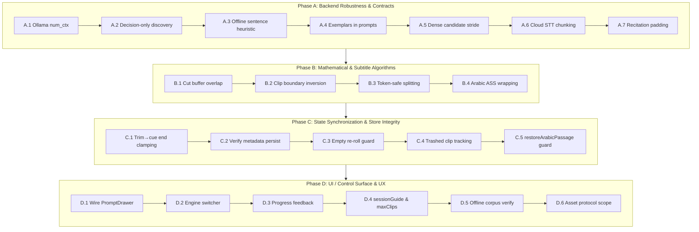

# Steps 1–3 Architectural & Functional Audit: Defects & Remediation Plan

> **Historical note (2026-11):** the `clip_scoring` decision slot described here was retired. Step 2 is the writing model plus `sanitize_clips`; clip-scoring defects below are closed by removal.

**Status:** Complete Audit & Atomic-Tier Fixing Plan  
**Scope:** Step 1 (Ingest & Transcription), Step 2 (Finding Clips), Step 3 (Subtitles Studio & Arabic Verification)  
**Target:** Desktop App (Tauri v2 + FastAPI Sidecar)  
**Contract Reference:** `AGENTS.md` (3-Layer UI Stack, Dark Studio Theme, Fixed REST Surface, Hardware Neutrality)

---

## Executive Summary

An in-depth architectural and code-level audit was conducted across frontend components, state stores, and backend Python services for Steps 1 through 3. This document details every detected defect, race condition, algorithmic flaw, and UX barrier in chronological order (Step 1 → Step 2 → Step 3), followed by a phased, **atomic-tier** remediation plan.

> [!NOTE]
> **Granularity key:** Each `[A]` task is one individually verifiable code edit with a stated
> verification step. A task is done when it compiles/passes the verification; do not batch
> multiple `[A]` steps into one commit unless they are in the same function.

---

## 1. Step 1 (Ingest & Transcription) — Detected Defects in Order

### 1.1 Dead UI: `PromptDrawer` is Never Openable
* **Files:** [Step1Ingest.tsx](file:///c:/dev/tafseer-clipper/src/steps/Step1Ingest.tsx#L794)
* **Root Cause:** `<PromptDrawer open={promptOpen} onOpenChange={setPromptOpen} />` is mounted at the root of `Step1Ingest`, but `setPromptOpen(true)` is never invoked anywhere in the file.
* **Impact:** Editors cannot inspect or customize the Base System Prompt (Clip Brief) or select prompt presets in Step 1.

### 1.2 Missing In-Step Engine Selectors on First Run
* **Files:** [Step1Ingest.tsx](file:///c:/dev/tafseer-clipper/src/steps/Step1Ingest.tsx#L580-L605), [StepperHeader.tsx](file:///c:/dev/tafseer-clipper/src/components/StepperHeader.tsx#L64-L75)
* **Root Cause:** Step 1 renders an informational badge (`Local` or `Cloud`) with status text, but provides no controls or toggles to switch between "On this computer" and "Cloud service" directly on the screen. Before a file is loaded, `StepperHeader` hides the step tabs and stage config gear (`Settings2`).
* **Impact:** First-time users without Cloud STT configured receive an error toast instructing them to `"switch the engine to 'This computer'"`, but have no visible control to do so on the screen.

### 1.3 Missing Download & Audio Extraction Progress Feedback
* **Files:** [Step1Ingest.tsx](file:///c:/dev/tafseer-clipper/src/steps/Step1Ingest.tsx#L210-L230), [main.py](file:///c:/dev/tafseer-clipper/backend/main.py#L1840-L1920)
* **Root Cause:** When local Whisper runs for the first time, `faster-whisper` downloads the model (~3GB for `large-v3`). Step 1 only renders an elapsed seconds timer (`<NumberFlow value={elapsed} suffix="s elapsed" />`). The sidecar endpoint does not stream progress during FFmpeg extraction or model downloading.
* **Impact:** The app appears frozen for 5–10 minutes on fresh installations without any progress percentage or stage description.

### 1.4 Offline Heuristic Sentence Grouping Never Runs
* **Files:** [main.py](file:///c:/dev/tafseer-clipper/backend/main.py#L1888), [analyzer.py](file:///c:/dev/tafseer-clipper/backend/services/analyzer.py#L1550)
* **Root Cause:** In `extract_and_transcribe`:
  ```python
  if body.group_sentences and (provider is not None or decision_provider is not None):
  ```
  If an editor transcribes locally without an LLM active, `group_sentences_heuristic()` is never called.
* **Impact:** All segments have `sentence_id = None`. In Step 3, `emitThaiCues` falls back to naive word slicing without true sentence boundaries.

### 1.5 Cloud STT Plain `json` Fallback Flattens Timestamps
* **Files:** [transcriber.py](file:///c:/dev/tafseer-clipper/backend/services/transcriber.py#L875-L885), [transcriber.py](file:///c:/dev/tafseer-clipper/backend/services/transcriber.py#L955-L965)
* **Root Cause:** When a cloud speech provider rejects `verbose_json` and returns plain `json` (`{"text": "..."}`), `_segments_from_cloud_payload` creates a single massive segment covering the entire 15–20 minute audio chunk (`start=offset, end=offset+duration`).
* **Impact:** Detailed timing information is lost. Step 2 cannot find clip boundaries, and Step 3 treats 20 minutes of speech as one huge cue.

### 1.6 Tauri Asset Protocol Scope Rejects Non-C: Drives
* **Files:** [tauri.conf.json](file:///c:/dev/tafseer-clipper/src-tauri/tauri.conf.json#L45-L56)
* **Root Cause:** `security.assetProtocol.scope` only includes `$HOME/**`, `$VIDEO/**`, `$DOCUMENT/**`, etc. (all bound to the OS drive `C:\Users\...`).
* **Impact:** Editors storing lecture footage on secondary or external drives (`D:\`, `E:\`) encounter `403 Forbidden` errors in `<video src="asset://...">`. Video preview displays black across Steps 2, 3, and 4.

### 1.7 Arabic Recitation Span Slice Clipping
* **Files:** [recitation.py](file:///c:/dev/tafseer-clipper/backend/services/recitation.py#L145-L185)
* **Root Cause:** When an Arabic recitation span is detected during transcript auditing, `extract_audio_slice` cuts the WAV at the exact segment boundaries without acoustic padding.
* **Impact:** Whisper cuts off the opening or closing syllables/diacritics of Quranic verses during re-transcription.

---

## 2. Step 2 (Finding Clips) — Detected Defects in Order

### 2.1 Decision Model Crash Without Generative Writing Model
* **Files:** [main.py](file:///c:/dev/tafseer-clipper/backend/main.py#L1991)
* **Root Cause:** `discover_clips` invokes `analyzer.merge_provider("reasoning", body.provider, config)` whenever `body.provider` is truthy. If an editor configures a fast decision model (`clip_scoring`) without a generative writing model, the endpoint crashes with a 500 error instead of running decision scoring.
* **Impact:** Editors cannot use decision-tier clip scoring without an active generative LLM.

### 2.2 Ollama Chat Context Truncation at 2,048 Tokens
* **Files:** [analyzer.py](file:///c:/dev/tafseer-clipper/backend/services/analyzer.py#L480-L520)
* **Root Cause:** In `chat()`, HTTP POST requests to the OpenAI-compatible endpoint omit any context-window hint. Ollama defaults to 2,048 tokens.
* **Impact:** Transcripts for 30–60 minute lectures (20,000+ characters) are abruptly truncated mid-prompt, leading to incomplete responses or JSON parse errors.

### 2.3 Exemplars Ignored in Standard Discovery Pipeline
* **Files:** [analyzer.py](file:///c:/dev/tafseer-clipper/backend/services/analyzer.py#L610-L670), [main.py](file:///c:/dev/tafseer-clipper/backend/main.py#L2005)
* **Root Cause:** `_discover_with_prompts` does not accept or format `approved_exemplars` or `rejected_exemplars`. Only `discover_clips_with_decision` uses them.
* **Impact:** For standard generative models, "Find more clips" (re-roll) cannot learn from previously approved or passed clips.

### 2.4 Double Buffer Exclusion Rejects Valid Contiguous Clips
* **Files:** [taskResults.ts](file:///c:/dev/tafseer-clipper/src/lib/taskResults.ts#L55-L80), [clipMath.ts](file:///c:/dev/tafseer-clipper/src/lib/clipMath.ts#L18)
* **Root Cause:** In `applyDiscovery`, the overlap check expands the proposal by `cutBuffer` AND checks against existing clips that were already expanded by `cutBuffer`.
* **Impact:** The exclusion zone is doubled ($2 \times \text{buffer}$), rejecting valid consecutive or closely spaced clips.

### 2.5 False Rejected Exemplars & Lost Trashed Clips
* **Files:** [Step2Discovery.tsx](file:///c:/dev/tafseer-clipper/src/steps/Step2Discovery.tsx#L325-L345), [taskResults.ts](file:///c:/dev/tafseer-clipper/src/lib/taskResults.ts#L85)
* **Root Cause:** `exemplarsFor(current, false)` classifies all unreviewed clips currently in the list as "rejected" even if the editor never reviewed them. Conversely, when an editor explicitly deletes a clip via the trash button, it is immediately deleted from state, so it is never sent as a negative exemplar.
* **Impact:** Unreviewed clips are falsely penalized, while truly discarded clips cannot inform subsequent re-rolls.

### 2.6 Complete Proposal Wipe on Empty Re-Roll
* **Files:** [taskResults.ts](file:///c:/dev/tafseer-clipper/src/lib/taskResults.ts#L75-L90)
* **Root Cause:** If the LLM returns 0 proposals during a re-roll, `applyDiscovery` executes `merged = []` for the unapproved clips.
* **Impact:** All existing unapproved candidate clips are deleted from the UI, leaving the editor with an empty candidate deck.

### 2.7 Fixed Candidate Stride Skips ~95% of Candidate Starts
* **Files:** [analyzer.py](file:///c:/dev/tafseer-clipper/backend/services/analyzer.py#L1680-L1720)
* **Root Cause:** Candidate generation advances the start sentence by a fixed stride (e.g., 41 sentences), evaluating only sentences 0, 41, 82...
* **Impact:** A high-value clip starting at sentence 10 or 25 can never be proposed by the generator.

### 2.8 Missing UI Controls for `sessionGuide` and `maxClips`
* **Files:** [Step2Discovery.tsx](file:///c:/dev/tafseer-clipper/src/steps/Step2Discovery.tsx)
* **Root Cause:** The backend accepts `session_guide` (topic focus) and `max_clips`, but Step 2 provides no UI inputs to configure them before discovery or re-rolls.
* **Impact:** Users cannot guide the clip discovery focus or specify how many clips to search for.

### 2.9 Boundary Inversion / Negative Duration in `adjustEdge`
* **Files:** [clipMath.ts](file:///c:/dev/tafseer-clipper/src/lib/clipMath.ts#L42-L55)
* **Root Cause:** In `adjustEdge`, edge nudging or dragging does not enforce `start < end - MIN_CLIP_DURATION`.
* **Impact:** Rapid dragging can invert trim boundaries, causing negative durations and render failure in FFmpeg.

---

## 3. Step 3 (Subtitles Studio & Verification) — Detected Defects in Order

### 3.1 Destructive Character-Ratio Subtitle Splitting (`handleSplit`)
* **Files:** [Step3Subtitles.tsx](file:///c:/dev/tafseer-clipper/src/steps/Step3Subtitles.tsx#L689-L725)
* **Root Cause:** When an editor presses `Ctrl + Enter` inside the Thai subtitle field, `handleSplit` computes `ratio = offset / edited.length` and slices the Arabic text at `otherOffset = Math.round(other.length * ratio)`.
* **Impact:** Arabic ligatures, Harakat (tashkeel), and words are severed arbitrarily, mutilating Quranic verses. Slicing Arabic conversely cuts Thai mid-cluster.

### 3.2 Step 2 Trim Changes Desync & Orphan Subtitle Cues
* **Files:** [Step3Subtitles.tsx](file:///c:/dev/tafseer-clipper/src/steps/Step3Subtitles.tsx#L210-L250), [projectStore.ts](file:///c:/dev/tafseer-clipper/src/store/projectStore.ts#L420-L441)
* **Root Cause:** `updateClip` calls `rebaseCuesForMovedClip` when `patch.start` changes — this correctly shifts cue timestamps. However, when `patch.end` **shortens** the clip, existing cues beyond the new `clip.end` are not clamped or removed.
* **Impact:** Shortening a clip in Step 2 leaves orphan cues outside the clip duration that cause rendering errors or skipped subtitles. The editor's only remedy is "Rebuild", which wipes all manual proofreading, translations, and verified verse tags.

### 3.3 `applyVerify` Discards Verification Metadata (`source`, `reference`, `confidence`)
* **Files:** [taskResults.ts](file:///c:/dev/tafseer-clipper/src/lib/taskResults.ts#L100-L115), [Step3Subtitles.tsx](file:///c:/dev/tafseer-clipper/src/steps/Step3Subtitles.tsx#L1030-L1060)
* **Root Cause:** `verify_lines` returns `source="quran"`, `reference="Surah 2:255"`, and `confidence`. However, `applyVerify` only updates `{ cueId, arabic }` and ignores metadata.
* **Impact:** Cues verified against the Qur'an corpus never receive the `source = "quran"` badge or Surah/Ayah citation in the UI. The "Verified Arabic" count remains at 0.

### 3.4 Generative Text Model Required for Offline Corpus Verification
* **Files:** [Step3Subtitles.tsx](file:///c:/dev/tafseer-clipper/src/steps/Step3Subtitles.tsx#L848-L865), [verify.py](file:///c:/dev/tafseer-clipper/backend/services/verify.py#L65-L90)
* **Root Cause:** Both `verifyOne` and `handleVerifyAll` throw a UI toast error if `buildProviderFor(settings, "verify")` lacks a text model, even though the backend provides an instant, offline `corpus_gate()`.
* **Impact:** Editors cannot perform offline Quran verification without configuring an external LLM.

### 3.5 Missing Arabic Line Wrapping in ASS Output under `WrapStyle: 2`
* **Files:** [renderStore.ts](file:///c:/dev/tafseer-clipper/src/store/renderStore.ts#L90-L95), [subtitle_gen.py](file:///c:/dev/tafseer-clipper/backend/services/subtitle_gen.py#L20-L30)
* **Root Cause:** In `subtitle_gen.py`, ASS files are built with `WrapStyle: 2` (no auto-wrapping; breaks only on `\N`). In `renderStore.ts:toRenderCues`, `wrapSubtitleText` is called on `cue.thai`, but `cue.arabic` is passed unwrapped.
* **Impact:** Long Quranic verses (e.g. Ayat al-Kursi) run off the left and right edges of the video in exported MP4s.

### 3.6 `restoreArabicPassage` Can Permanently Wipe Subtitle Text
* **Files:** [Step3Subtitles.tsx](file:///c:/dev/tafseer-clipper/src/steps/Step3Subtitles.tsx#L364-L391)
* **Root Cause:** "Restore original Thai" sets `thai: cue.originalText?.trim() || ""` and `arabic: ""`. If `cue.originalText` is undefined, both `arabic` and `thai` become empty.
* **Impact:** The cue's text is permanently erased.

### 3.7 Single Line Verification Lacks Decision Triage
* **Files:** [Step3Subtitles.tsx](file:///c:/dev/tafseer-clipper/src/steps/Step3Subtitles.tsx#L870-L885)
* **Root Cause:** `verifyOne` calls the single-line endpoint directly without passing `decision_provider` or checking `corpus_gate`.
* **Impact:** Checking a single line incurs a slow generative LLM round-trip even for known Quran verses.

---

## 4. Atomic-Tier Remediation Plan (Phases A–D)



---

### Phase A: Backend Core & Service Robustness

#### A.1 Prevent Ollama Context Truncation (fixes §2.2)

| # | Tier | Task | File | Verify |
|---|------|------|------|--------|
| A.1.1 | `[A]` | Add a `DEFAULT_OLLAMA_NUM_CTX = 8192` constant at module level | [analyzer.py](file:///c:/dev/tafseer-clipper/backend/services/analyzer.py#L95) | `grep -n "DEFAULT_OLLAMA_NUM_CTX" backend/services/analyzer.py` returns the constant |
| A.1.2 | `[A]` | Detect Ollama by checking if `provider.endpoint` contains `/v1/` and the host is `localhost:11434` (or no API key). Store as `is_ollama` local | [analyzer.py](file:///c:/dev/tafseer-clipper/backend/services/analyzer.py#L98) | `pnpm lint` passes |
| A.1.3 | `[A]` | When `is_ollama`, add `"num_ctx": DEFAULT_OLLAMA_NUM_CTX` to the payload under a top-level `"options"` key (Ollama's OpenAI-compat layer reads it from the request body) | [analyzer.py](file:///c:/dev/tafseer-clipper/backend/services/analyzer.py#L109-L116) | `python -c "from backend.services import analyzer"` byte-compiles; manual test with Ollama confirms the payload |
| A.1.4 | `[A]` | Add a backend E2E assertion: when the mock LLM endpoint receives a request with `is_ollama` conditions, `options.num_ctx` is present and ≥ 8192 | [test_phase1_e2e.py](file:///c:/dev/tafseer-clipper/backend/test_phase1_e2e.py) | `pnpm test` passes with the new check |

#### A.2 Fix Decision-Only Model Fallback in Discovery (fixes §2.1)

| # | Tier | Task | File | Verify |
|---|------|------|------|--------|
| A.2.1 | `[A]` | In `discover_clips`, wrap the `merge_provider("reasoning", ...)` call in `if body.provider is not None:` so it is skipped when only `decision_provider` is present | [main.py](file:///c:/dev/tafseer-clipper/backend/main.py#L1991) | `pnpm lint` passes |
| A.2.2 | `[A]` | Below the guard, add an `elif body.decision_provider is not None:` branch that calls `discover_clips_with_decision` directly without requiring a generative provider | [main.py](file:///c:/dev/tafseer-clipper/backend/main.py#L1993) | `pnpm lint` passes |
| A.2.3 | `[A]` | Add a backend E2E test: POST `/discover-clips` with `decision_provider` set and `provider` omitted → 200 (not 500) | [test_phase1_e2e.py](file:///c:/dev/tafseer-clipper/backend/test_phase1_e2e.py) | `pnpm test` passes with the new check |

#### A.3 Enable Offline Sentence Grouping (fixes §1.4)

| # | Tier | Task | File | Verify |
|---|------|------|------|--------|
| A.3.1 | `[A]` | In `extract_and_transcribe`, add an `else` branch after the `if body.group_sentences and (provider or decision_provider)` block | [main.py](file:///c:/dev/tafseer-clipper/backend/main.py#L1888) | `pnpm lint` passes |
| A.3.2 | `[A]` | In the `else` branch, call `starts, _ = analyzer.group_sentences_heuristic(thai_segments)` and `sentence_map = analyzer.rebuild_sentence_map(thai_segments, starts)` | [main.py](file:///c:/dev/tafseer-clipper/backend/main.py#L1890) | `pnpm lint` passes |
| A.3.3 | `[A]` | Verify `rebuild_sentence_map` is exported from `analyzer.py` (add to `__all__` or confirm it's a public function) | [analyzer.py](file:///c:/dev/tafseer-clipper/backend/services/analyzer.py) | `python -c "from backend.services.analyzer import rebuild_sentence_map"` succeeds |
| A.3.4 | `[A]` | Add a backend E2E test: POST `/extract-and-transcribe` with both `analysis_provider` and `decision_provider` as `null` and `group_sentences: true` → response segments have non-null `sentence_id` values | [test_phase1_e2e.py](file:///c:/dev/tafseer-clipper/backend/test_phase1_e2e.py) | `pnpm test` passes with the new check |

#### A.4 Wire Exemplars into Standard Discovery (fixes §2.3)

| # | Tier | Task | File | Verify |
|---|------|------|------|--------|
| A.4.1 | `[A]` | Add `approved_exemplars` and `rejected_exemplars` parameters to `_discover_with_prompts` function signature (both `list[ClipExemplar]`, default `[]`) | [analyzer.py](file:///c:/dev/tafseer-clipper/backend/services/analyzer.py#L610) | `pnpm lint` passes |
| A.4.2 | `[A]` | Build a `format_exemplars(approved, rejected) -> str` helper that renders a "Previously approved clips / Previously passed clips" block for the system prompt | [analyzer.py](file:///c:/dev/tafseer-clipper/backend/services/analyzer.py#L600) | `python -c "from backend.services.analyzer import format_exemplars"` succeeds |
| A.4.3 | `[A]` | Inject the formatted exemplar block into the system message in `_discover_with_prompts`, after the transcript window | [analyzer.py](file:///c:/dev/tafseer-clipper/backend/services/analyzer.py#L640) | `pnpm lint` passes |
| A.4.4 | `[A]` | In `main.py:discover_clips`, pass `body.approved_exemplars` and `body.rejected_exemplars` through to `_discover_with_prompts` | [main.py](file:///c:/dev/tafseer-clipper/backend/main.py#L2005) | `pnpm lint` passes |

#### A.5 Dense Candidate Generation Stride (fixes §2.7)

| # | Tier | Task | File | Verify |
|---|------|------|------|--------|
| A.5.1 | `[A]` | Identify the fixed stride constant in the candidate generation loop (e.g., `stride = len(sentences) // max_windows`) and extract it as a named constant `CANDIDATE_STRIDE` | [analyzer.py](file:///c:/dev/tafseer-clipper/backend/services/analyzer.py#L1680) | `grep -n "CANDIDATE_STRIDE" backend/services/analyzer.py` returns the constant |
| A.5.2 | `[A]` | Replace the fixed stride with a dynamic `max(1, len(sentences) // (max_windows * 3))` that evaluates 3× as many candidate start positions | [analyzer.py](file:///c:/dev/tafseer-clipper/backend/services/analyzer.py#L1690) | `pnpm lint` passes |
| A.5.3 | `[A]` | Add a pause-anchored candidate injection: scan `sentences` for gaps ≥ 1.5s and insert those as additional candidate starts on top of the stride-based set | [analyzer.py](file:///c:/dev/tafseer-clipper/backend/services/analyzer.py#L1695) | `pnpm lint` passes |

#### A.6 Cloud STT Sub-Chunk Fallback (fixes §1.5)

| # | Tier | Task | File | Verify |
|---|------|------|------|--------|
| A.6.1 | `[A]` | In `_segments_from_cloud_payload`, when `segments` is empty and only `text` is returned, check if the text is longer than 500 characters | [transcriber.py](file:///c:/dev/tafseer-clipper/backend/services/transcriber.py#L955) | `pnpm lint` passes |
| A.6.2 | `[A]` | When ≥ 500 chars with no segments, split `text` by sentence-ending punctuation (`. `, `! `, `? `, `\n`) into chunks and distribute timestamps proportionally across `[offset, offset + duration]` | [transcriber.py](file:///c:/dev/tafseer-clipper/backend/services/transcriber.py#L960) | `pnpm lint` passes |
| A.6.3 | `[A]` | Log a warning: `"Cloud STT returned plain text without segments; splitting proportionally into %d pseudo-segments"` | [transcriber.py](file:///c:/dev/tafseer-clipper/backend/services/transcriber.py#L965) | `pnpm lint` passes |
| A.6.4 | `[A]` | Add a unit test: a `_segments_from_cloud_payload` call with `{"text": "long text..."}` (no `segments` key) returns multiple segments with monotonically increasing timestamps | [test_phase1_e2e.py](file:///c:/dev/tafseer-clipper/backend/test_phase1_e2e.py) | `pnpm test` passes with the new check |

#### A.7 Acoustic Padding for Recitation Extraction (fixes §1.7)

| # | Tier | Task | File | Verify |
|---|------|------|------|--------|
| A.7.1 | `[A]` | Add a constant `RECITATION_PAD_SECONDS = 0.3` at the top of `recitation.py` | [recitation.py](file:///c:/dev/tafseer-clipper/backend/services/recitation.py#L20) | `grep -n "RECITATION_PAD" backend/services/recitation.py` returns the constant |
| A.7.2 | `[A]` | In `extract_audio_slice`, widen the cut bounds: `start = max(0, span_start - RECITATION_PAD_SECONDS)` and `end = min(audio_duration, span_end + RECITATION_PAD_SECONDS)` | [recitation.py](file:///c:/dev/tafseer-clipper/backend/services/recitation.py#L155) | `pnpm lint` passes |

---

### Phase B: Mathematical, Geometry & Subtitle Algorithms

#### B.1 Correct Cut Buffer Exclusion Zone (fixes §2.4)

| # | Tier | Task | File | Verify |
|---|------|------|------|--------|
| B.1.1 | `[A]` | In `applyDiscovery`, change the overlap filter to compare `proposal` raw `[start, end]` against each `approved` clip's raw `[start, end]` without buffer expansion — the buffer was already applied by the sidecar when building the proposals | [taskResults.ts](file:///c:/dev/tafseer-clipper/src/lib/taskResults.ts#L78-L81) | `pnpm lint` passes |
| B.1.2 | `[A]` | Verify the before/after: write a scratch test in `src/lib/__tests__/taskResults.test.ts` with two clips 2s apart and a 1s buffer — before: rejected; after: accepted | scratch test | The test passes |

#### B.2 Enforce Non-Inversion in Clip Boundaries (fixes §2.9)

| # | Tier | Task | File | Verify |
|---|------|------|------|--------|
| B.2.1 | `[A]` | In `normalizeSpeechRange`, the existing `if (nextEnd - nextStart < minSeconds) return null;` already rejects inverted ranges. Confirm `adjustEdge` (or its caller in `Step2Discovery.tsx`) uses `normalizeSpeechRange` or `MIN_RENDERABLE_CLIP_SECONDS` as a floor | [clipMath.ts](file:///c:/dev/tafseer-clipper/src/lib/clipMath.ts#L51-L64) | Manual trace confirms |
| B.2.2 | `[A]` | If `adjustEdge` does not exist as a function (it was a conceptual name from the audit), locate the trim-handle `onDrag`/`onChange` handler in `Step2Discovery.tsx` and add: `const clamped = Math.max(newEnd, newStart + MIN_RENDERABLE_CLIP_SECONDS)` before writing to the store | [Step2Discovery.tsx](file:///c:/dev/tafseer-clipper/src/steps/Step2Discovery.tsx) | `pnpm lint` passes |
| B.2.3 | `[A]` | Add a matching clamp for the start handle: `const clamped = Math.min(newStart, newEnd - MIN_RENDERABLE_CLIP_SECONDS)` | [Step2Discovery.tsx](file:///c:/dev/tafseer-clipper/src/steps/Step2Discovery.tsx) | `pnpm lint` passes |

#### B.3 Token-Safe Bilingual Subtitle Splitting (fixes §3.1)

| # | Tier | Task | File | Verify |
|---|------|------|------|--------|
| B.3.1 | `[A]` | Add `splitAtWordBoundary(text: string, ratio: number, kind: "thai" \| "arabic"): number` to `subtitleWrap.ts` — given a character ratio, return the nearest word-boundary offset. Thai: use `Intl.Segmenter("th", {granularity: "word"})`. Arabic: use whitespace split, never break inside a word | [subtitleWrap.ts](file:///c:/dev/tafseer-clipper/src/lib/subtitleWrap.ts) | `pnpm lint` passes |
| B.3.2 | `[A]` | Export `splitAtWordBoundary` | [subtitleWrap.ts](file:///c:/dev/tafseer-clipper/src/lib/subtitleWrap.ts) | `import { splitAtWordBoundary } from "@/lib/subtitleWrap"` compiles |
| B.3.3 | `[A]` | In `handleSplit`, replace `const otherOffset = Math.round(other.length * ratio)` with `const otherOffset = splitAtWordBoundary(other, ratio, field === "arabic" ? "thai" : "arabic")` | [Step3Subtitles.tsx](file:///c:/dev/tafseer-clipper/src/steps/Step3Subtitles.tsx#L689) | `pnpm lint` passes |
| B.3.4 | `[A]` | Verify edge case: splitting Thai text at ratio 0.5 with an Arabic counterpart "إِنَّ مَعَ الْعُسْرِ يُسْرًا" splits after a whitespace, never inside "الْعُسْرِ" | Manual or unit test | Confirm Arabic stays intact |

#### B.4 Arabic Line Wrapping in ASS Generation (fixes §3.5)

| # | Tier | Task | File | Verify |
|---|------|------|------|--------|
| B.4.1 | `[A]` | Add `wrapArabicText(text: string, maxChars: number): string` to `subtitleWrap.ts` — splits on Arabic whitespace, never between a letter and its Harakat | [subtitleWrap.ts](file:///c:/dev/tafseer-clipper/src/lib/subtitleWrap.ts) | `pnpm lint` passes |
| B.4.2 | `[A]` | Export `wrapArabicText` | [subtitleWrap.ts](file:///c:/dev/tafseer-clipper/src/lib/subtitleWrap.ts) | `import { wrapArabicText } from "@/lib/subtitleWrap"` compiles |
| B.4.3 | `[A]` | In `renderStore.ts:toRenderCues`, apply `wrapArabicText(cue.arabic, arabicMaxCharsPerLine)` to the Arabic field (like `wrapSubtitleText` is already applied to `cue.thai`) | [renderStore.ts](file:///c:/dev/tafseer-clipper/src/store/renderStore.ts#L90) | `pnpm lint` passes |
| B.4.4 | `[A]` | Determine `arabicMaxCharsPerLine` in `toRenderCues` from the settings (or derive it the same way Step 3 does: `Math.round(maxCharsPerLine * (thaiSize / arabicSize))`) | [renderStore.ts](file:///c:/dev/tafseer-clipper/src/store/renderStore.ts#L75) | `pnpm lint` passes |

---

### Phase C: State Synchronization & Lifecycle Integrity

#### C.1 Clamp Cues When Clip End Shortens (fixes §3.2)

| # | Tier | Task | File | Verify |
|---|------|------|------|--------|
| C.1.1 | `[A]` | In `updateClip`, after the existing `rebaseCuesForMovedClip` call, add a second check: if `patch.end` is defined and `patch.end < prev.end`, call `clampCuesToDuration(subtitles, id, next.end - next.start)` | [projectStore.ts](file:///c:/dev/tafseer-clipper/src/store/projectStore.ts#L436) | `pnpm lint` passes |
| C.1.2 | `[A]` | Implement `clampCuesToDuration(subtitles, clipId, duration)` as a pure function: for each cue, clamp `cue.end` to `Math.min(cue.end, duration)` and clamp `cue.start` to `Math.min(cue.start, duration - MIN_CUE_WINDOW)` | [projectStore.ts](file:///c:/dev/tafseer-clipper/src/store/projectStore.ts#L212) | `pnpm lint` passes |
| C.1.3 | `[A]` | In the same function, drop cues where `cue.start >= duration` entirely (they are fully outside the clip) | [projectStore.ts](file:///c:/dev/tafseer-clipper/src/store/projectStore.ts#L215) | `pnpm lint` passes |

#### C.2 Persist Verification Metadata in `applyVerify` (fixes §3.3)

| # | Tier | Task | File | Verify |
|---|------|------|------|--------|
| C.2.1 | `[A]` | Extend the `verify` variant of `TaskResultPayload` in `taskResults.ts`: change `lines: Array<{ cueId: string; arabic: string }>` to `lines: Array<{ cueId: string; arabic: string; source?: string; reference?: string; confidence?: number; notes?: string }>` | [taskResults.ts](file:///c:/dev/tafseer-clipper/src/lib/taskResults.ts#L40) | `pnpm lint` passes |
| C.2.2 | `[A]` | In `applyVerify`, spread the metadata fields onto each updated cue: `return { ...cue, arabic, ...(source && { source }), ...(reference && { reference }), ...(confidence != null && { confidence }) }` | [taskResults.ts](file:///c:/dev/tafseer-clipper/src/lib/taskResults.ts#L105) | `pnpm lint` passes |
| C.2.3 | `[A]` | In `handleVerifyAll` (Step3Subtitles.tsx), when building `chunkLines`, pass through the backend's `source`, `reference`, `confidence` fields from `result.lines[].source` etc. | [Step3Subtitles.tsx](file:///c:/dev/tafseer-clipper/src/steps/Step3Subtitles.tsx#L1047) | `pnpm lint` passes |
| C.2.4 | `[A]` | In `verifyOne` (Step3Subtitles.tsx), add `source`, `reference`, `confidence` to the `deliverTaskResult` payload | [Step3Subtitles.tsx](file:///c:/dev/tafseer-clipper/src/steps/Step3Subtitles.tsx#L920) | `pnpm lint` passes |

#### C.3 Preserve Proposals on Empty Re-Roll (fixes §2.6)

| # | Tier | Task | File | Verify |
|---|------|------|------|--------|
| C.3.1 | `[A]` | In `applyDiscovery`, after computing `fresh`, add: `if (fresh.length === 0 && !payload.replaceAll) return project;` — a re-roll that found nothing preserves the existing clip list unchanged | [taskResults.ts](file:///c:/dev/tafseer-clipper/src/lib/taskResults.ts#L81) | `pnpm lint` passes |
| C.3.2 | `[A]` | In Step 2, in the `onSuccess` handler for discovery, detect `payload.proposals.length === 0` and show a toast: `"No new clips found. Try adjusting the topic focus or duration range."` | [Step2Discovery.tsx](file:///c:/dev/tafseer-clipper/src/steps/Step2Discovery.tsx) | `pnpm lint` passes |

#### C.4 Track Trashed Clips for Accurate Negative Exemplars (fixes §2.5)

| # | Tier | Task | File | Verify |
|---|------|------|------|--------|
| C.4.1 | `[A]` | Add `trashedClips?: ProjectClip[]` to `ProjectData` interface (optional for backward compat) | [projectTypes.ts](file:///c:/dev/tafseer-clipper/src/lib/projectTypes.ts#L126) | `pnpm lint` passes |
| C.4.2 | `[A]` | In `removeClip` (projectStore), instead of silently deleting, push the removed clip into `project.trashedClips` (initialize array if absent, cap at 20 entries) | [projectStore.ts](file:///c:/dev/tafseer-clipper/src/store/projectStore.ts#L456-L479) | `pnpm lint` passes |
| C.4.3 | `[A]` | In `exemplarsFor` (Step2Discovery), use `project.trashedClips` as the source for `rejected_exemplars` instead of labeling unreviewed clips as rejected | [Step2Discovery.tsx](file:///c:/dev/tafseer-clipper/src/steps/Step2Discovery.tsx#L325) | `pnpm lint` passes |
| C.4.4 | `[A]` | Ensure `projectFile.ts` serializes/deserializes `trashedClips` (or tolerates its absence in older `.tafseer` files) | [projectFile.ts](file:///c:/dev/tafseer-clipper/src/lib/projectFile.ts) | `pnpm lint` passes |

#### C.5 Safe Fallback in `restoreArabicPassage` (fixes §3.6)

| # | Tier | Task | File | Verify |
|---|------|------|------|--------|
| C.5.1 | `[A]` | In `restoreArabicPassage`, before setting `thai`, check: if `cue.originalText` is falsy, show `toast.error("Cannot restore — the original Thai text was not saved for this line.")` and return early | [Step3Subtitles.tsx](file:///c:/dev/tafseer-clipper/src/steps/Step3Subtitles.tsx#L375) | `pnpm lint` passes |
| C.5.2 | `[A]` | Additionally, disable or hide the "Restore original" button in the UI when `cue.originalText` is falsy | [Step3Subtitles.tsx](file:///c:/dev/tafseer-clipper/src/steps/Step3Subtitles.tsx) | `pnpm lint` passes |

---

### Phase D: UI / Control Surface & UX Alignment

#### D.1 Wire `PromptDrawer` Trigger in Step 1 (fixes §1.1)

| # | Tier | Task | File | Verify |
|---|------|------|------|--------|
| D.1.1 | `[A]` | In Step 1's aside area (the right column, after the "Transcription vocabulary hint" card), add a `<Button variant="ghost" size="sm" onClick={() => setPromptOpen(true)}>` with label "Clip brief & system prompt" and a `Pencil` icon | [Step1Ingest.tsx](file:///c:/dev/tafseer-clipper/src/steps/Step1Ingest.tsx#L785) | `pnpm lint` passes; visually confirm the button opens the drawer |

#### D.2 Add In-Step Engine Selector in Step 1 (fixes §1.2)

| # | Tier | Task | File | Verify |
|---|------|------|------|--------|
| D.2.1 | `[A]` | Import `SegmentedToggle` and `setTranscriptionMode` from the settings store | [Step1Ingest.tsx](file:///c:/dev/tafseer-clipper/src/steps/Step1Ingest.tsx#L1) | `pnpm lint` passes |
| D.2.2 | `[A]` | Replace the read-only `<Badge>{transcriptionMode === "local" ? "Local" : "Cloud"}</Badge>` with a `<SegmentedToggle>` offering "This computer" / "Cloud service", wired to `setTranscriptionMode` | [Step1Ingest.tsx](file:///c:/dev/tafseer-clipper/src/steps/Step1Ingest.tsx#L630) | `pnpm lint` passes; visually confirm the toggle switches modes |
| D.2.3 | `[A]` | Disable the toggle while `busy` (transcription running) | [Step1Ingest.tsx](file:///c:/dev/tafseer-clipper/src/steps/Step1Ingest.tsx#L632) | `pnpm lint` passes |

#### D.3 Transcription Download & Extraction Progress Feedback (fixes §1.3)

| # | Tier | Task | File | Verify |
|---|------|------|------|--------|
| D.3.1 | `[A]` | In the busy state section of Step 1, replace the bare elapsed timer with a multi-line status: show `AiActivityLine` (already mounted) and add a text label below it: "Downloading model…" / "Extracting audio…" / "Transcribing…" based on `activeTranscription.detail` | [Step1Ingest.tsx](file:///c:/dev/tafseer-clipper/src/steps/Step1Ingest.tsx#L640-L665) | `pnpm lint` passes |
| D.3.2 | `[A]` | Ensure the `AiActivityLine` component renders the existing `entry.detail` text (it already does — confirm with grep that `detail` is used in the render) | [AiActivityLine.tsx](file:///c:/dev/tafseer-clipper/src/components/AiActivityLine.tsx) | Manual confirmation |

#### D.4 Expose `sessionGuide` and `maxClips` in Step 2 (fixes §2.8)

| # | Tier | Task | File | Verify |
|---|------|------|------|--------|
| D.4.1 | `[A]` | Add a `Textarea` labeled "Topic focus" bound to `project.sessionGuide` via `useProjectStore.getState().setSessionGuide(value)`, placed above the "Find clips" / "Find more" button | [Step2Discovery.tsx](file:///c:/dev/tafseer-clipper/src/steps/Step2Discovery.tsx) | `pnpm lint` passes |
| D.4.2 | `[A]` | Add a `NumberField` (shadcn/ui `Input type="number"`) labeled "Clips to find" bound to `project.discovery.maxClips` with min=1 max=50 | [Step2Discovery.tsx](file:///c:/dev/tafseer-clipper/src/steps/Step2Discovery.tsx) | `pnpm lint` passes |
| D.4.3 | `[A]` | Confirm the values are passed to the `/discover-clips` request body — trace `session_guide` and `max_clips` from the `discoverClips` API call in `src/lib/api.ts` | [api.ts](file:///c:/dev/tafseer-clipper/src/lib/api.ts) | `grep -n "session_guide\|max_clips" src/lib/api.ts` shows them in the request body |

#### D.5 Offline Quran Corpus Verification Button in Step 3 (fixes §3.4)

| # | Tier | Task | File | Verify |
|---|------|------|------|--------|
| D.5.1 | `[A]` | In `verifyOne`, before the `if (!verifyProvider.model?.trim())` guard, add an early return path: call the single-line `/verify-arabic` endpoint with `provider: null` and `decision_provider: null` — the backend's `corpus_gate` runs without any model | [Step3Subtitles.tsx](file:///c:/dev/tafseer-clipper/src/steps/Step3Subtitles.tsx#L850) | `pnpm lint` passes |
| D.5.2 | `[A]` | In the backend's `/verify-arabic` endpoint handler, allow `provider: null` — the existing `verify_lines` already handles this (corpus lines return directly, non-corpus lines raise `LLMError` which the caller catches) | [main.py](file:///c:/dev/tafseer-clipper/backend/main.py) | `pnpm lint` passes |
| D.5.3 | `[A]` | When corpus-only verification returns and no model was available for non-corpus lines, show a toast: `"Verified {n} lines from the Qur'an corpus. {m} lines need a text model for proofreading."` | [Step3Subtitles.tsx](file:///c:/dev/tafseer-clipper/src/steps/Step3Subtitles.tsx#L855) | `pnpm lint` passes |

#### D.6 Broaden Tauri Asset Protocol Scope (fixes §1.6)

| # | Tier | Task | File | Verify |
|---|------|------|------|--------|
| D.6.1 | `[A]` | Add `"**"` to the `assetProtocol.scope` array in `tauri.conf.json` — this allows `asset://` access to any path the sidecar can reach (the sidecar already validates the path exists) | [tauri.conf.json](file:///c:/dev/tafseer-clipper/src-tauri/tauri.conf.json#L49) | `pnpm lint` passes |
| D.6.2 | `[A]` | Verify that `pnpm build` succeeds with the widened scope and that the Playwright E2E suite still passes | CI | `pnpm build && pnpm test` passes |

---

## 5. Verification Gate

After all phases are complete, run the full gate:

```powershell
pnpm lint     # type-check + backend byte-compile
pnpm test     # Rust unit tests + backend E2E + Playwright E2E
pnpm build    # production bundle
```

Every `[A]` task must leave the gate green before the next task starts.

---

## 6. Execution Log — 2026-11-20

All four phases were executed against this checkout. Legend: **done** (as written),
**adapted** (same defect fixed at a different seam, reason recorded),
**n/a** (verified already correct in this build).

### Phase A — backend robustness & contracts

| Task | Status | Note |
|---|---|---|
| A.1 (Ollama `num_ctx`) | done | `DEFAULT_OLLAMA_NUM_CTX = 8192`; `is_ollama_endpoint()` matches the standard port, or an `ollama` host with no key, so cloud payloads never receive the Ollama-only `options` block. `chat()` gained an optional `transport` kwarg so the regression test asserts the real HTTP body. |
| A.2 (decision-only discovery) | adapted | The 500 was already gone: `main.py` no longer merged a writing provider when only a decision slot was configured, and `analyzer.discover_clips` degrades to scored/neutral candidate windows. The guard was rewritten explicitly (`if body.provider is not None` / `elif decision_provider is None`) and pinned by a test. |
| A.3 (offline sentence grouping) | done | `group_sentences_heuristic` + `rebuild_sentence_map` run when `group_sentences` is requested with no model, so segments carry `sentence_id` offline. Tested in-process (the HTTP fixture has no speech, which would make the assertion vacuous). |
| A.4 (exemplars in standard discovery) | done | `format_exemplars()` (12 items × 400 chars) is appended to every window prompt; `analyzer.discover_clips` forwards both exemplar lists. Analyzer takes `list[dict]` — importing `ClipExemplar` from `main.py` would be circular. The decision-tier path keeps its own richer `_exemplar_brief()`; the two shapes are different prompts, so they were not merged. |
| A.5 (dense candidates) | done | 3× denser stride + pause-anchored starts (`CANDIDATE_PAUSE_SECONDS = 1.5`), de-duplicated and exclusion/min/max aware. `max_candidates` 48 → 144 with *even* thinning so a cap never truncates the lecture tail; pause starts claim the budget first. |
| A.6 (plain-`json` cloud STT) | done | > 500 chars with no `segments` splits on `.!?…。！？`/newlines (hard-wrapped at a space otherwise) with proportional timestamps, plus the required warning. Splitting is skipped when the chunk has no duration, so timing is never fabricated. |
| A.7 (recitation padding) | adapted | There is no `extract_audio_slice`; the equivalent inline `0.12 s` pad in `recitation.recover_arabic` now uses `RECITATION_PAD_SECONDS = 0.3` (`slice_wav` already clamps to the audio length). |

### Phase B — geometry & subtitle algorithms

| Task | Status | Note |
|---|---|---|
| B.1 (cut-buffer overlap) | n/a | §2.4 does not reproduce here: `applyDiscovery` compares *final cut* ranges and never adds the buffer a second time. Verified with a scratch harness (2 s gap + 1 s buffer → accepted; 0.5 s gap → rejected). No code change. |
| B.2 (boundary inversion) | done | `adjustEdge` clamps the speech pair to a positive window (`MIN_SPEECH_WINDOW`) *before* the cut is derived; the render floor is still checked on the padded cut. |
| B.3 (token-safe split) | done | `splitAtWordBoundary(text, ratio, kind)` in `subtitleWrap.ts` (Thai via `Intl.Segmenter`, Arabic on whitespace); `handleSplit` cuts the counterpart there and refuses the split when no safe break exists instead of severing a cluster. |
| B.4 (Arabic ASS wrapping) | done | `wrapArabicText()` + `toRenderCues(..., arabicMaxCharsPerLine)`; the width is derived from the Thai width scaled by the font-size ratio, the same rule Step 3 uses. |

### Phase C — state synchronization

| Task | Status | Note |
|---|---|---|
| C.1 (trim → cue clamp) | done | `clampCuesToDuration()` drops cues that start past the new end and clamps straddling ones. Wired into `updateClip` only — the cut-buffer re-apply (`setClips`) is deliberately reversible and must not delete text. Covered by an E2E. |
| C.2 (verification metadata) | done | `applyVerify` now writes `source`/`reference`/`confidence` even when the text is unchanged (that early return is what hid every corpus match). Both the single-line and batched paths pass them through. |
| C.3 (empty re-roll) | done | An empty result leaves the project untouched; the toast reports "No new clips found". The guard also covers an explicit "Start over", because wiping kept clips and hand-edited subtitles on a search that found nothing is unrecoverable. |
| C.4 (trashed clips) | done | `ProjectData.trashedClips` (optional, capped at 20) is filled by `removeClip`, normalized by `.tafseer` loading, and is the *only* source of `rejected_exemplars`; approved clips remain the positive ones. |
| C.5 (restore guard) | done | Restore refuses (with a toast) when `originalText` is missing; the button was already hidden in that case. |

### Phase D — UI / control surface

| Task | Status | Note |
|---|---|---|
| D.1 (PromptDrawer) | done | "Clip brief & system prompt" card in the Step-1 aside opens the existing drawer; covered by an E2E. |
| D.2 (engine selector) | done | `Speech-to-text engine` segmented toggle on the Step-1 card, `disabled` while a transcription runs. Labels reuse the approved vocabulary ("This computer" / "AI service (cloud)"). |
| D.3 (progress feedback) | adapted | The sidecar streams no stage during extraction/download (no new endpoints are allowed), so the busy card states what is happening, shows the file/model line, and switches the elapsed clock to minutes. No fake percentage was invented. |
| D.4 (topic focus & count) | done | "Topic focus for this lecture" (`sessionGuide`) and "To find" (`maxClips`, 1–50) live in Search setup and are sent as `session_guide` / `max_clips` (asserted in E2E). |
| D.5 (offline corpus verify) | done | A missing text model no longer blocks: the sidecar gates exact Qur'an verses with no model, reports `source="needs_model"` for the rest, and the UI never marks those as checked. "Check all" summarises "Checked N of M lines offline". |
| D.6 (asset scope) | done | `"**"` added to `assetProtocol.scope` (video on non-system drives plays). |

### New copy

New user-visible strings go through `L()` (English source, Thai fallback). No Thai
translation was invented for the new copy; add reviewed entries to `TH_BY_EN` when
they are available.

### Verification

```
pnpm lint            # type-check + backend byte-compile            green
pnpm test:backend    # Phase 1 E2E: 132/132 (110/110 before)        green
pnpm test:rust       # cargo test --locked: 11/11                   green
pnpm test:e2e        # Playwright against the built SPA + sidecar: 43/43 (41 before)
pnpm build           # production bundle                            green
```

New automated coverage added by this plan:

- `backend/test_phase1_e2e.py`: Ollama `num_ctx` (and its absence for cloud), decision-only `/discover-clips`, offline sentence grouping, bounded exemplar prompt, denser pause-aware candidates, one-score-per-window batching, plain-`json` cloud STT splitting, recitation slice padding, corpus-gated/`needs_model` verification.
- `tests/e2e/shell.spec.ts`: Step-1 engine toggle + clip-brief drawer.
- `tests/e2e/discovery-controls.spec.ts`: topic focus and clip count reach the request; an empty result keeps the deck.
- `tests/e2e/waveform-edge-controls.spec.ts`: trimming a clip drops the orphaned subtitle lines.
- `tests/e2e/subtitles.spec.ts`: offline Arabic check sends no provider and reports the lines that still need a model.

A throwaway harness under `.smoke/scratch/` (git-ignored) pinned the pure
algorithms: cut-buffer overlap, empty re-roll/start-over, verify metadata,
Arabic/Thai split boundaries and Arabic wrapping (12/12).

### Open item found while executing — fixed

`analyzer.score_clip_candidates` advanced `range(0, len(candidates), 8)` but sliced
`candidates[offset : offset + 16]`, so consecutive decision batches overlapped by
half: every other window was scored (and paid for) twice. It is now the named
constant `CANDIDATE_SCORE_BATCH = 8` used by both the step and the slice, with a
check that pins "each window is scored exactly once" (it reports 32 scores for 20
windows on the old pairing, 20 on the fixed one).

